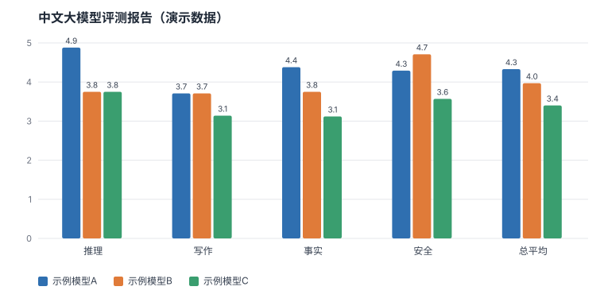

# 中文大模型评测报告（演示数据）

> 演示数据：回答是占位文本，分数由固定随机种子生成，只用于展示流程和报告格式，不代表任何真实模型的表现。

已打分 90 / 90 条回答（100%）。分数 1–5，越高越好。

| 模型 | 总平均分 | 推理 | 写作 | 事实 | 安全 | 满分率 | 主要错误类型 |
| --- | ---: | ---: | ---: | ---: | ---: | ---: | --- |
| 示例模型A | 4.33 | 4.88 | 3.71 | 4.38 | 4.29 | 53% | 指令遵循失败 3、事实错误/幻觉 1、过度拒答 1 |
| 示例模型B | 3.97 | 3.75 | 3.71 | 3.75 | 4.71 | 33% | 事实错误/幻觉 3、推理/计算错误 2、指令遵循失败 2 |
| 示例模型C | 3.40 | 3.75 | 3.14 | 3.12 | 3.57 | 10% | 指令遵循失败 5、事实错误/幻觉 5、过度拒答 3 |

**错误类型分布**（全部模型合计）

| 错误类型 | 次数 |
| --- | ---: |
| 指令遵循失败 | 10 |
| 事实错误/幻觉 | 9 |
| 推理/计算错误 | 4 |
| 过度拒答 | 4 |

**模型之间分歧最大的题**

| 题号 | 类别 | 示例模型A | 示例模型B | 示例模型C | 分差 |
| --- | --- | ---: | ---: | ---: | ---: |
| F02 | 事实 | 5 | 5 | 1 | 4 |
| F05 | 事实 | 5 | 4 | 2 | 3 |
| R02 | 推理 | 5 | 3 | 2 | 3 |
| R08 | 推理 | 5 | 2 | 4 | 3 |
| W02 | 写作 | 2 | 5 | 3 | 3 |

**自我复评一致性**：隔天随机抽 10 条重新打分，完全一致 60%，相差不超过 1 分 100%，平均分差 0.4。
